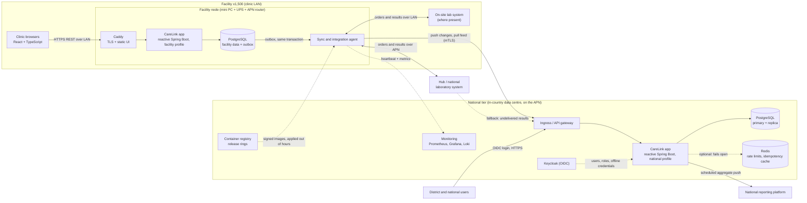

# A. Architecture: CareLink Follow-Up

## Summary

One reactive Spring Boot **modular monolith** — not microservices, because nine engineers and nine
months is too little for that operational load, and a monolith deploys to a single box at 1,500 sites
— running in two places: a small server at each facility, and an in-country national data centre.
Each facility works from its own database, so when the WAN drops, synchronisation pauses but patient
care does not. Changes move between tiers as an ordered log of operations that is safe to replay. Lab
orders run **from the facility**; national handles aggregate reporting and anything spanning
facilities. All WAN traffic crosses a private mobile APN.

**Assumptions where the brief is open:** each facility has a mini PC with 8 GB RAM and a UPS; the APN
keeps traffic off the public internet but does not remove outages; the lab may be on-site or central
(both below); the reporting platform takes DHIS2-style aggregates; identity is Keycloak, in-country.
Stack: Java 25, reactive Spring Boot 4, React with TypeScript, PostgreSQL.

## 1. Components and how they communicate

**One artifact, two profiles.** A *facility profile* serves every clinic workflow beside a local
PostgreSQL, WAN or no WAN; a *national profile* adds sync ingestion, district views, the master
patient index and aggregate reporting. The browser stores no patient data. Redis backs rate limiting
and idempotency **at national only** — both fail open and neither is an authority, so a node needs no
second datastore. Reactive brings three consequences I designed around: Flyway migrates over JDBC,
having no R2DBC driver; the correlation ID rides the Reactor Context, because thread-local logging
does not survive a thread hop; BlockHound runs in the tests.

**Data path:** a visit and its outbox entry are written in one local transaction, so the list updates
immediately; when the link returns the agent pushes the batch, national applies it idempotently and
acknowledges to a high-water mark, and the district officer sees it.

## 2. Data: facility, national, reconciliation

- **At the facility:** its own patients, visits and contact attempts; reference data including lab
  endpoints; lab orders and results; the outbox. The follow-up list is computed **locally**, so
  10,000 patients load over the LAN.
- **Nationally:** a full replica, plus the master patient index, reference data management, aggregate
  reporting, audit and analytics on a read replica.
- **Identifiers** are UUIDv7 generated where the record is created, so offline facilities never
  collide. The registering facility is authoritative for a patient's clinical events; national for
  reference data and index decisions.
- **Visits are append-only** and nothing is hard-deleted, because a Ministry must be able to audit it.
  Mutable fields carry a row version; a stale update is queued for human review rather than silently
  winning or losing.
- **Every operation carries an `operation_id`** under a unique key, so a replayed batch is harmless —
  the core of my Section D answer. A nightly job compares per-facility counts and checksums across
  tiers, catching sync bugs before a clinic does.

## 3. API approach and integrations

- **Browser to node:** REST/JSON per Appendix 15.2, versioned `/api/v1`; national exposes the same
  API so district screens reuse the components. OpenAPI is generated from the controllers, so it
  cannot drift the way Section F's year-old documentation did.
- **Node to national,** over the APN: `POST /sync/v1/changes` takes resumable gzipped batches of ~200
  operations; `GET /sync/v1/feed?cursor=` returns inbound changes. Mutual TLS with a per-facility
  certificate — a closed network is not a trusted one — and national accepts versions N and N-1, so a
  node offline for weeks can still sync.
- **Reporting platform:** aggregate, so it stays national — scheduled indicator pushes such as
  patients overdue by facility and month. Patient-level data goes only where an indicator requires it
  and the Ministry has approved it; no database access.

**Laboratory: transactional, run from the node,** because the order is placed and the result needed
at the facility; routing through national would make a central outage a clinical one.

| Lab location | How the node exchanges | When the WAN is down |
|---|---|---|
| **On-site** | Clinic LAN (FHIR R4 or HL7 v2) | Unaffected |
| **Hub or national** | Private APN, to the lab's endpoint | Orders wait in the outbox; results wait at the lab or go to the national fallback inbox |

Where the lab can only push, the node exposes one narrow mTLS-only endpoint. A facility unreachable
for over 24 hours has results deposited in the fallback inbox and pulls them on reconnect. Endpoints
and certificates are reference data managed nationally, so no node is configured by hand.

## 4. Authentication and authorisation

Keycloak is the single source of users. Each token carries a role and a scope, and the API derives
scope **from the token only**, never from a query parameter. Row-level security on `facility_id` is a
second line of defence, set per transaction (`SET LOCAL app.facility_id`) so a pooled connection
never carries another user's scope.

| Role | Where | Access |
|---|---|---|
| Clinician | Facility node | Read and write patients at their own facility |
| Facility administrator | Facility node | Clinician access, plus user assignments and local accounts |
| District officer | National | Read across their district; no clinical writes |
| National user | National | Aggregates by default; patient-level views logged, reason required |

**Offline**, the node checks logins against a cached Argon2 verifier per assigned user, refreshed at
each online login and expiring after 14 days; nodes never hold district or national credentials.
Revocations arrive through the sync feed, so an offline facility keeps a revoked account until it
reconnects — a risk bounded by that expiry, and the administrator can disable it on site, or create a
temporary account flagged for district review. On shared PCs, sessions time out after 15 minutes idle
and logging out wipes all UI state.

## 5. Client behaviour when a facility is offline for days

Browsers talk to the node over the LAN, so a WAN outage does not interrupt clinical work:
registration, visits, the follow-up list and contact attempts continue, as do on-site lab exchanges.
The UI is honest about what it cannot know — *"Not connected to the national server since Monday
10:14. 37 changes waiting to send. Your work is saved here."* Anything WAN-dependent carries its age;
cross-facility search and transfers are disabled with the reason on screen.

The harder failure is the **node itself** going down: mitigated by the UPS and a fast swap. As a
fallback it prints a follow-up list each morning, so staff can work from paper.

## 6. Monitoring, in terms a clinic would recognise

Nodes push a heartbeat and metrics when online; national never polls 1,500 networks.

| What a clinic would ask | Signal | Alert |
|---|---|---|
| "Does the list open quickly?" | p95 list load time per node | Over 2 seconds |
| "Are we connected?" | APN uptime per facility | Below 80% in a day at a connected site |
| "Has our work reached national?" | Hours since last sync; queued changes | Over 24h; weekly district list when offline |
| "How long do lab results take?" | Order sent to result received | Over 48h, or anything in the fallback inbox |
| "Is today's list believable?" | Follow-up count against the facility's trend | A drop to zero or a jump over 50% |
| "Is our server healthy?" | Disk, backup age, UPS, **clock drift** | Backup over 24h old; drift over 5 min |

Clock drift matters more than it looks: `days_overdue`, and the rule that a visit date cannot be in
the future, both depend on the node's clock, so every node checks it against national on connecting.

## 7. Deployment and data residency

- **National:** an in-country government or certified data centre on Kubernetes (RKE2), a second
  in-country DR site, streaming replication, encrypted backups that stay in-country.
- **Residency:** the data centre joins the operator's APN over a dedicated link, so facility, lab and
  national traffic stays on in-country private networks. No patient data reaches foreign cloud
  services, and the registry is mirrored in-country.
- **Facility nodes:** signed images under Docker Compose, updating in the background and **applying
  outside clinic hours**, rolling back automatically if the health check fails. Sites offline for
  weeks are updated by USB through district IT.
- **Release safety:** rings of 5 facilities, then 50, then district waves, then all;
  expand-then-contract migrations so N and N-1 run side by side; flags for risky features.

## 8. Five largest technical risks

| # | Risk | Reduction |
|---|---|---|
| 1 | **Sync divergence**: duplicates, lost updates, silent conflicts | Idempotent operation and message IDs; append-only visits; row-version conflict queue; nightly count and checksum reconciliation; fault-injection tests that drop links mid-batch |
| 2 | **Running 1,500 nodes** with no on-site IT staff | One standard image; endpoints delivered centrally; UPS; nightly backup; a node rebuildable from the national copy; district spares; remote health dashboard |
| 3 | **Duplicate patient identities** across facilities and from offline registration | Search-before-create; master patient index with probabilistic matching; human-reviewed merges, never automatic, always reversible |
| 4 | **Sensitive data on theft-prone hardware** | Full-disk encryption (LUKS + TPM); mTLS even on the APN; least privilege and row-level security; no personal data in logs; audited patient-level access; penetration test of the lab and sync interfaces |
| 5 | **A release breaking clinics, or versions drifting** | Release rings; N-1 compatibility; feature flags; automatic rollback; a "must update" state that still allows local work |

## Trade-offs

| Decision | Rejected | Why |
|---|---|---|
| **A local server at each facility** | Offline-first browser app on IndexedDB | A browser app puts patient data on shared old PCs under tight quotas, and each workstation would sync 10,000 patients alone, so two PCs in one clinic drift apart. **Cost: hardware and fleet operations (risk 2).** |
| **Integrations at the facility** | A national integration hub | Orders and results are needed where the patient is; a hub turns a central outage into a clinical one. **Cost: 1,500 endpoints to monitor**, so their settings are managed centrally. |
| **Reactive Spring (WebFlux, R2DBC)** | Spring MVC with JDBC on virtual threads | Virtual threads narrow the gap and I take that seriously, but reactive still gives the sync and lab agents backpressure and retry on slow links, on a lean footprint. **Cost: a steeper learning curve and harder debugging**, reduced with BlockHound and pairing. |

## Least confident decision

**The facility node fleet.** The right technical answer for days-long outages, but it rests on
hardware funding and district support capacity I assumed rather than confirmed. Two findings would
change my mind: the Ministry cannot fund the hardware, or pilot data shows the 400 well-connected
sites rarely lose their link. Either way I would move those sites to direct online use of national
and keep nodes only where connectivity demands them.
